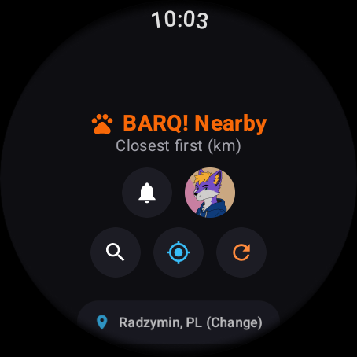
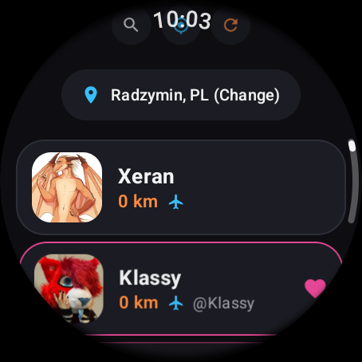
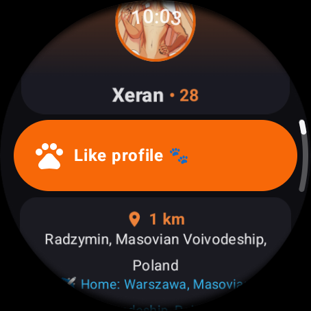
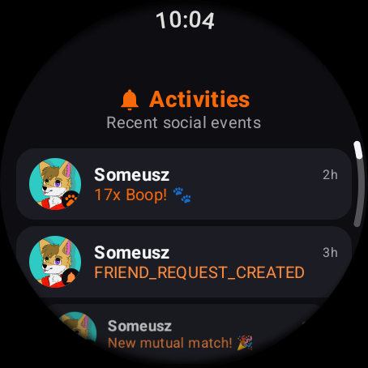
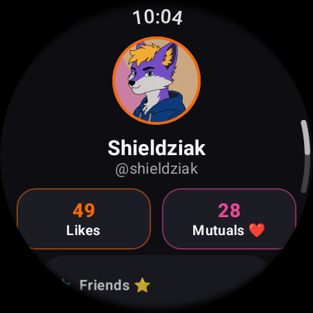
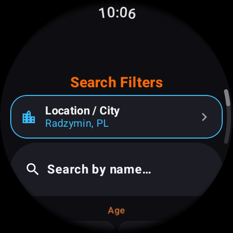
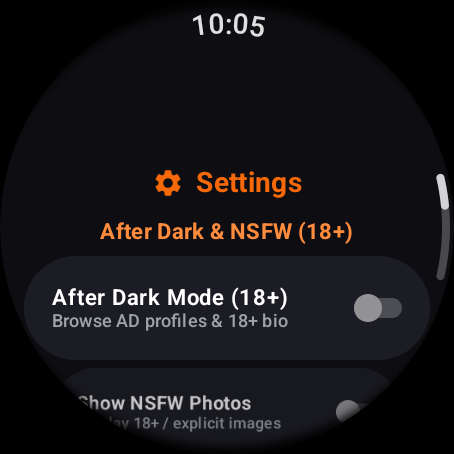
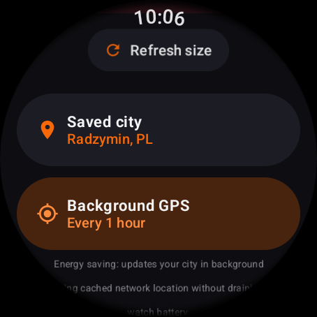

# BARQ! Wear OS 🐾⌚

An open-source, standalone **Wear OS** client for **[BARQ!](https://barq.app)** built with **Jetpack Compose for Wear OS** and **Kotlin**.

Browse nearby profiles sorted by distance, filter users with a watch-friendly menu, view full profiles, fursonas, galleries, and like/boop profiles right from your wrist.

> **Disclaimer:** This is an unofficial community project and is not affiliated with, endorsed by, or maintained by BARQ! or its creators.

---

## 📸 Screenshots

<div align="center">

| **Nearby & Action Bar** | **Nearby Furs List** | **Profile & Fursonas** | **Activities & Boops** |
| :---: | :---: | :---: | :---: |
|  |  |  |  |

| **My Account** | **Search Filters** | **Settings & Mode** | **Background Auto GPS** |
| :---: | :---: | :---: | :---: |
|  |  |  |  |

</div>

---

## ✨ Features

- **🔐 Standalone Authentication**:
  - **QR Code Login (OAuth2 PKCE)**: Generates an official `BARQ!;LOGIN;<hash>` QR code directly on your watch screen. Scan it in the mobile BARQ! app (*Menu → Scan QR Code*) to log in automatically.
  - **Manual Token Input**: Paste an `ory_at_...` (Access Token) or `ory_rt_...` (Refresh Token) via the watch keyboard/remote input.
  - **ADB Deep Link**: Quickly inject tokens during development or from a companion device via `barq://token`.
  - **Automatic Token Refresh**: Seamlessly refreshes expired access tokens using the stored `ory_rt_` refresh token.
- **📍 Nearby Grid, Distance Sorting & Wear-Optimized Action Bar**:
  - Displays nearby profiles sorted from **closest to furthest (`km`)**.
  - **Ergonomic 2-Row Round Action Bar**: Perfectly fits circular watch faces (such as Galaxy Watch 4/5/6/7 and Pixel Watch). Top row features the **Activities / Notifications Bell** (with real-time unread badge counter) and **My Profile** avatar; bottom row hosts **Filters/Search**, **Update GPS**, and **Refresh**.
  - Supports rotary crown/bezel scrolling and infinite pagination.
- **🧭 GPS, Manual City Search & Battery-Safe Background Auto-Sync**:
  - Uses the watch's built-in GPS when available (`UpdateGpsLocation`).
  - **Background GPS Auto-Sync (WorkManager)**: Configurable in Settings (`Disabled`, `Every 1 hour`, `Every 3 hours`, `Every 6 hours`). Uses battery-safe cached network/phone location (`getLastKnownLocation`) to refresh your city in the background without draining watch battery.
  - **Manual City Search (`Places` GraphQL query)**: Search and select any city worldwide when GPS is unavailable or disabled.
  - **Persistent City Selection**: Your chosen city is saved across app restarts and sessions.
- **🔔 Activities & Notifications Center**:
  - Instant access via the top-bar bell icon or **My Account**.
  - Displays incoming **Boops 🐾**, mutual matches 🎉, and friend requests with relative timestamps.
- **🎛️ Wear OS Search Filters**:
  - **Display Name** search
  - **Age Range** (`Min` / `Max` with `- / +` steppers, presets, and manual input)
  - **Genders** (`Female`, `Male`, `Transgender Female`, `Transgender Male`, `Non-Binary`)
  - **Relationship Status** (`Single`, `In a relationship`, `In an open relationship`, `Engaged / married`, `Domestic partnership`, `Other`)
  - **Sexual Orientation** (`Straight`, `Bisexual`, `Gay`, `Lesbian`, `Pansexual`, `Asexual`, `Questioning`, `Other`)
  - **Search Options**: `Require Profile Image`, `Relations (Mutuals / Friends / Likes)`
  - **After Dark (18+)**: Toggle After Dark mode and filter by `Sexual Position` (`Top`, `Bottom`)
- **👤 Full Profile, Fursona & After Dark (18+) Viewer**:
  - View avatars, banners, distance & travel indicator, biography, genders, orientation, languages, interests/hobbies, social links, groups, and conventions/events.
  - **After Dark (18+) & NSFW Support**:
    - **First-Time Post-Login Prompt**: Asks on first login whether to enable **After Dark (18+) & NSFW** content or keep **SFW Only** mode.
    - **Settings Toggles**: Switch **After Dark Mode (18+)** and **Show NSFW Photos** on or off at any time in **Settings**.
    - **After Dark Profile Section & Kinks**: Displays After Dark biography, sexual position, role/behaviour (`Dominant`, `Submissive`, `Switch`), safe sex preference, hosting availability (`Can host`), and profile kinks (`Give` / `Receive` ratings) when enabled.
  - Browse **Fursonas** (species, fursuit badge, and reference sheet gallery).
  - Like / Boop profiles and individual gallery photos.
  - **My Account, Clickable Relation Lists & News**:
    - Tap **Likes**, **Mutuals ❤️**, or **Friends ⭐** in **My Account** to browse dedicated, distance-sorted lists of your mutuals, likes, and friends.
    - **BARQ! News 📰**: Read official BARQ! announcements and articles directly on your watch.
    - Open your own full BARQ! profile with one tap.
- **🖼️ Image Caching & Storage Management**:
  - Memory cache (up to 25% RAM) + Disk cache (up to 100 MB) powered by Coil for fast offline-ready avatar and photo loading.
  - **Settings Screen**: Inspect the current image cache size and clear it with one tap.
- **🌍 Multi-Language Support (i18n)**:
  - **English (`en`)** as the primary/default language.
  - **Polish (`pl`)** translation included out of the box.
  - In-app language switcher in **Settings** (`System Default`, `English`, `Polski`).
- **⌚ Energy-Efficient Wear OS Tiles**:
  - **BARQ! Nearby (Full Tile)**: Displays up to 4 closest nearby furs in a 2×2 grid with circular avatars, display names, and distance (`km`), plus a shortcut to open the app.
  - **BARQ! Nearby (Compact Tile)**: Displays the 3 closest furs in a compact horizontal strip.
  - **Battery-Friendly Design**: Reads from a shared local snapshot cache (`30-minute` freshness interval, zero background GPS wakeups, OLED true-black background `#000000`, and cached `56×56` circular thumbnails). Tapping any fur opens their profile directly.

---

## 📥 Download

Pre-built, ready-to-install APKs are available on the **[GitHub Releases](https://github.com/Shieldowskyy/BARQ_wear/releases)** page!

1. Download the latest `BARQ_wear-vX.Y.Z-universal-release.apk` from [Releases](https://github.com/Shieldowskyy/BARQ_wear/releases/latest).
2. Install it onto your watch via ADB or your favorite Wear OS installer app (such as [Bugjaeger](https://play.google.com/store/apps/details?id=eu.sisik.hackendebug) or GeminiMan Wear OS Manager):
   ```bash
   adb install -r BARQ_wear-v1.0.1-universal-release.apk
   ```

---

## 🛠️ Tech Stack

- **Language**: Kotlin (`JVM 17`)
- **UI Framework**: Jetpack Compose for Wear OS (`androidx.wear.compose:compose-material` & `compose-foundation`)
- **Navigation**: `SwipeDismissableNavHost` (`androidx.wear.compose:compose-navigation`)
- **Networking**: OkHttp 4 + Gson (GraphQL client for `https://api.barq.app/graphql` & OAuth2 PKCE client for `https://auth.barq.app`)
- **Image Loading & Caching**: Coil (`io.coil-kt:coil-compose`)
- **QR Code Generation**: ZXing (`com.google.zxing:core`)
- **Min SDK**: `26` (Android 8.0 / Wear OS 2+) • **Target / Compile SDK**: `34` (Wear OS 4 / 5)

---

## 🚀 Getting Started

### Prerequisites

- **Android Studio** (Jellyfish / Koala or newer) or Android SDK Command-Line Tools
- **JDK 17+**
- A Wear OS watch (with ADB debugging enabled) or a **Wear OS Emulator** (`API 30–34`)

### Build & Install

1. **Clone the repository**:
   ```bash
   git clone https://github.com/Shieldowskyy/BARQ_wear.git
   cd BARQ_wear
   ```

2. **Build the debug or release APK**:
   ```bash
   ./gradlew assembleDebug
   # or for an optimized release build:
   ./gradlew assembleRelease
   ```
   The compiled APK will be generated with full version and architecture info, e.g.:
   `app/build/outputs/apk/debug/BARQ_wear-v1.0.1-universal-debug.apk`
   `app/build/outputs/apk/release/BARQ_wear-v1.0.1-universal-release.apk`

3. **Install on a connected Wear OS device or emulator**:
   ```bash
   adb install -r app/build/outputs/apk/debug/app-debug.apk
   adb shell am start -n yt.dsh.barq_wear/.MainActivity
   ```

   Or use the helper script to build, boot a Wear OS AVD, install, and launch automatically:
   ```bash
   ./run_wear_avd.sh
   ```

---

## 🔑 Logging In via ADB (Optional)

In addition to scanning the QR code on the watch screen, you can push an existing BARQ! token over ADB:

```bash
# Using an access token and optional refresh token:
adb shell am start -a android.intent.action.VIEW \
  -d "barq://token?access_token=ory_at_YOUR_ACCESS_TOKEN&refresh_token=ory_rt_YOUR_REFRESH_TOKEN"
```

---

## 🌍 Adding a New Language (Localization Guide)

BARQ! Wear is designed so anyone in the community can easily contribute new translations.
**English (`res/values/strings.xml`)** is the primary fallback language.

To add a new language (for example, German `de`):

1. **Create a new values directory** for your language code:
   ```bash
   mkdir -p app/src/main/res/values-de
   cp app/src/main/res/values/strings.xml app/src/main/res/values-de/strings.xml
   ```
2. **Translate the strings** inside `app/src/main/res/values-de/strings.xml`.
3. **Register the locale** in [`app/src/main/res/xml/locales_config.xml`](app/src/main/res/xml/locales_config.xml):
   ```xml
   <locale android:name="de" />
   ```
4. **Add the language entry** to [`AppLanguage`](app/src/main/java/yt/dsh/barq_wear/ui/AppLocale.kt) so it appears in the in-app Settings picker:
   ```kotlin
   enum class AppLanguage(val code: String, val nativeLabel: String) {
       SYSTEM("system", ""),
       EN("en", "English"),
       PL("pl", "Polski"),
       DE("de", "Deutsch");
   ```

---

## 📁 Project Structure

```text
app/src/main/
├── AndroidManifest.xml
├── java/yt/dsh/barq_wear/
│   ├── MainActivity.kt              # App entry point, Coil cache config & Wear navigation host
│   ├── data/
│   │   ├── BarqApiClient.kt         # GraphQL queries, mutations & response parsers
│   │   ├── BarqAuthManager.kt       # OAuth2 PKCE QR login, token refresh & SharedPreferences
│   │   └── BarqModels.kt            # Data models, filter options & distance sorting helpers
│   └── ui/
│       ├── AppLocale.kt             # Language configuration & runtime locale provider
│       ├── BarqTheme.kt             # Color palette & rotary scroll modifier
│       ├── BarqViewModel.kt         # State management, pagination, GPS & cache controls
│       ├── LoginScreen.kt           # QR code & manual token login UI
│       ├── NearbyScreen.kt          # Nearby list, Filters menu, City search, Account & Settings UI
│       └── ProfileDetailScreen.kt   # Full profile viewer, Fursona cards & galleries
└── res/
    ├── values/strings.xml           # Default strings (English)
    ├── values-pl/strings.xml        # Polish strings
    └── xml/locales_config.xml       # Supported Android locales configuration
```

---

## 📄 License

This project is licensed under the **MIT License** — see the [LICENSE](LICENSE) file for details.
